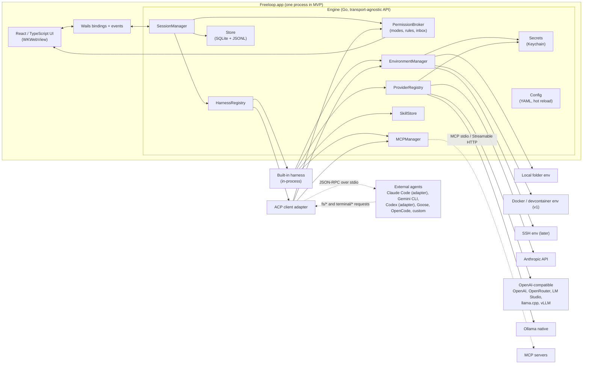

# Architecture

Architecture for **Freeloop**. M0 built the store, event schema, engine API, config skeleton and secrets interface (as `secrets.Store`); the rest is proposed; interface sketches are Go-flavoured pseudocode meant to fix names and responsibilities, not to compile. Requirement IDs refer to [REQUIREMENTS.md](REQUIREMENTS.md); unsettled points refer to [OPEN_QUESTIONS.md](OPEN_QUESTIONS.md).

## 1. Stack

| Layer | Choice | Why |
|---|---|---|
| Core (engine) | **Go** | Supervising many child processes (harnesses, MCP servers, shells, PTYs, git) with goroutines and contexts; one static binary; official Go SDKs for MCP, Anthropic, OpenAI and Google; the author is productive in it |
| Desktop shell | **Wails v3** (v3.0.0, released 2026-10-26, pinned) on WKWebView | Go-native shell with multi-window, generated TypeScript bindings for Go services, and an event bus; v2.17 as fallback (OQ-002) |
| Frontend | **React + TypeScript** | Largest component ecosystem and best AI-assisted code generation; the author will not hand-write most of it (OQ-004) |
| Harness protocol | **ACP** (Agent Client Protocol), JSON-RPC over stdio | Already spoken by Claude Code (via adapter), Gemini CLI, Codex (via adapter), Goose, OpenCode, Cline and 40-odd others; its permission and tool-call model is a good normalization target |
| Tools protocol | **MCP** via the official Go SDK (v1.7+, spec 2026-07-28, with older revisions for existing servers) | Stateless revision with `server/discover` and multi round-trip requests; the SDK handles version negotiation |
| Skills | **Agent Skills** (`SKILL.md`) | De facto standard; the author's existing skills load unchanged |
| Storage | **SQLite** (pure-Go driver) for index and metadata, **JSONL** per session for transcripts, **YAML** for config | Readable, greppable, crash-safe appends, no server |
| Secrets | **macOS Keychain** behind a `Secrets` interface | Never in files; platform backends swappable (NFR-XPLAT-002) |
| Git | Shell out to `git` | `go-git` lacks worktrees and lags on porcelain features; `git` is always present where this app is useful |

### Alternatives considered

| Alternative | Why not (for this project) |
|---|---|
| Python core with pywebview or PySide6 | Best agent-framework ecosystem, but packaging and signing a Python desktop app on macOS is a recurring tax, startup is slower, and the harness-authoring benefit is preserved anyway by running harnesses out of process over ACP |
| TypeScript with Electron | Official ACP and MCP TypeScript SDKs and the biggest contributor pool, but the author is not productive in TypeScript for backend work and the runtime is 150 MB plus Node |
| Tauri 2 with a Rust core | Smallest binaries and an official ACP Rust SDK, but Rust slows a solo developer's iteration and the author did not ask for it |
| Native SwiftUI | Best macOS feel, but Swift, macOS forever, and no ACP SDK |
| Pure-Go GUI (Fyne, Gio) | Rich text, markdown, diffs and accessibility are weak; a transcript view would look worse than every competitor |
| Wails v2 instead of v3 | Stable, but single-window and an older bindings model; chosen as fallback only |
| An existing Go agent framework (Genkit, Eino, LangChainGo, ADK) for the built-in harness | Each imposes its own loop and abstractions; the loop is the product here, and thin adapters over the three official SDKs plus one OpenAI-compatible adapter cover every listed provider |

## 2. Component diagram



## 3. Process model

**MVP: one process.** The Wails app hosts the engine in-process. Child processes are: external harnesses (ACP over stdio), stdio MCP servers, shell commands and PTYs spawned by environments, and `git`/`docker` invocations. Each child belongs to a process group owned by its session so cancellation kills the whole tree.

**Why not a daemon from day one.** A separate engine daemon would let sessions survive a GUI crash and give the headless CLI for free, at the cost of an IPC layer and process lifecycle work before anything else exists. The engine API is designed transport-agnostic (section 11) and all state is persisted per event (SES-002), so a GUI crash loses nothing but in-flight streams, and the daemon split can happen at v1 with EXT-004 (OQ-003).

**Concurrency.** The `SessionManager` runs each session as a goroutine group under a per-session `context.Context`. Provider calls go through a per-provider semaphore (OQ-013). *As built in M2:* `internal/engine/limit.go` wraps a session's provider so a model call takes one of the provider's `maxConcurrent` slots (default 4) and frees it when its stream ends; a call that has to wait marks the session `queued` until it gets one. Events fan out through a bus with bounded buffers; the store subscriber is synchronous (persist before publish), UI subscribers are asynchronous and may fall back to catch-up reads from the store if they lag. The race detector runs in CI; a chaos test runs ten sessions with random cancels.

## 4. Core abstractions

### 4.1 Provider

A configured model endpoint: one Anthropic key, one OpenRouter key, one local Ollama. Providers know nothing about agents.

```go
type Provider interface {
    ID() string
    Type() ProviderType                 // anthropic | openai_compat | ollama | (v1) gemini | openai_responses
    ListModels(ctx) ([]ModelInfo, error)
    Capabilities(model string) ModelCaps
    Stream(ctx, ChatRequest) (<-chan ChatEvent, error) // text deltas, thought deltas, tool-call deltas, usage, stop reason
    CountTokens(ctx, ChatRequest) (int, error)        // estimate when the API has no counter
}

type ModelCaps struct {
    Tools, ToolChoice, ParallelTools, StreamedToolArgs, StableToolCallIDs bool
    StructuredOutput, Vision, Reasoning, PromptCaching bool
    ContextWindow, MaxOutput int
}
```

Normalization rules live in one package: synthesize tool-call IDs when a runtime omits them (Ollama native returns an index only), buffer streamed tool arguments until the JSON is complete, map reasoning fields (`thinking`, `reasoning_content`, `reasoning`) to one `ThoughtDelta`, and disable parallel tool calls when `ParallelTools` is false. Local runtimes get a tool-calling probe on first use that fills `ModelCaps` (PRV-005, OQ-011).

### 4.2 Harness and sessions

A harness is anything that can run an agent session. The interface is deliberately shaped like ACP so that the ACP adapter is a one-to-one mapping and the built-in harness is "an ACP agent linked in-process".

```go
type Harness interface {
    Info() HarnessInfo                                  // id, name, kind (builtin|acp|cli), negotiated capabilities
    NewSession(ctx, SessionParams) (SessionHandle, error)
    LoadSession(ctx, externalID string, SessionParams) (SessionHandle, error) // replays history; only if capable
}

type SessionParams struct {
    Env        Environment
    Profile    Profile          // model, prompt, tools, policy, skills, MCP servers, limits
    Cwd        string
    MCPServers []MCPServerSpec  // resolved from profile + environment, paths valid inside Env
}

type SessionHandle interface {
    Prompt(ctx, []ContentBlock) (StopReason, error) // end_turn | max_tokens | max_turns | refusal | cancelled
    Cancel(ctx) error
    SetMode(ctx, ModeID) error                      // ask | accept_edits | plan | bypass, plus harness-defined modes
    SetConfig(ctx, key string, value any) error     // model, thought level, harness-specific options
    Events() <-chan Event
    Close() error
}
```

*As built in M1 (`internal/harness`):* sessions receive an `Emit(type, data)` function in their parameters instead of exposing an event channel, so every event goes straight to the store (persist, then publish); cancel is the prompt's context; `SetConfig` waits until a harness needs it. The built-in harness records each context message as a `history_message` event, which is how a session continues with its full context after a restart. A prompt is text plus embedded resources: the engine reads the files a message `@`-mentions through the session's environment and hands them to the harness, as an ACP client embeds resources, so mentions work the same for every harness (GUI-004); the transcript shows each one as a `resource_link` user content block.

*As built in M2 (HRN-003):* a profile is `config.Profile`, loaded from `profiles/<id>.yaml` with unknown fields rejected and validation problems reported with their line; the session records its profile ID, the project records a default profile, and `config.yaml` has a fallback under `defaults.profileId`. Provider, model and mode come from the profile when the new-session request leaves them empty. When a session starts, the engine passes the profile's effort, system prompt (added after the harness's own, before project instructions), tool list (`present_plan` stays available for plan mode), turn cap and instruction policy in `harness.Params`; a running session keeps them, while the profile's rules are read at every permission check, between the global and the session rules. Slash commands follow ACP (GUI-004): the engine records the profile's commands as an `available_commands_update` event when a session is created and again when it starts with a changed list, the harness expands a prompt that starts with `/name` (the built-in harness from `harness.Params.Commands`), and the GUI only lists what the event says, so an ACP agent's own commands appear the same way. Mode commands are the GUI's, since modes are common to every harness.

The engine-side `Session` record is what the GUI lists:

```go
type Session struct {
    ID, ProjectID, EnvironmentID, HarnessID, ProfileID string
    ExternalID   string          // harness-side id for ACP session/load or session/resume
    Title        string
    Status       SessionStatus   // idle | running | waiting_permission | waiting_input | error | archived
    Model        ModelRef
    Mode         ModeID
    BaseCommit, Branch string    // for the diff panel and git badge
    Usage        Usage
    CreatedAt, UpdatedAt time.Time
}
```

### 4.3 Environment

Where a session's processes run and where its files are. Every tool execution, file access and PTY goes through this interface; a lint rule forbids `os/exec` and direct file I/O elsewhere in the engine (ENV-001).

```go
type Environment interface {
    ID() string
    Kind() EnvKind                     // local | docker | ssh
    Root() string                      // project root as seen inside the environment
    Capabilities() EnvCaps             // sandboxed, network, pty, setup/health supported
    Exec(ctx, ExecSpec) (Process, error) // argv, cwd, env (with secret refs resolved at spawn), stdin, pty, timeout, output caps
    FS() FileSystem                    // Read, Write, Stat, List, Glob, Grep; path policy enforced here
    Setup(ctx) error                   // post-create script (v1)
    Health(ctx) error
}
```

*As built for v1 (SES-010):* a session can have its own git worktree, recorded as the session's `worktree`; `Session.WorkRoot()` is where its environment, diff panel and `@` mentions work, while `projectRoot` keeps the project it belongs to. Worktrees are created with `git worktree add -b freeloop/<title>-<random> <path> HEAD` under `<data folder>-worktrees/<project>/`, next to the data folder (the protected-path policy covers the data folder itself) and outside the repository; archiving runs `git worktree remove`, which refuses when there is uncommitted work (the session then keeps it and says so), unarchiving checks the branch out again, and branches are never deleted. "Merge…" in the Diff tab runs `git merge --no-ff --no-edit` of the session's branch in the main checkout, only when both sides have no uncommitted changes to tracked files, and aborts a conflicting merge. Like the diff panel these commands need a trusted project whose git config names no programs, and run with hooks off. The worktree's branch is recorded with the session (`worktree_branch`), apart from the branch the git state reports, which can be empty; archive keeps a worktree whose HEAD has left that branch, since removing it would strand its commits.

*As built in M2:* the local environment also implements `Spawner` (`Spawn(ctx, SpawnSpec) (Process, error)`) for long-running processes that talk over stdio: MCP servers now, ACP agents next.

*As built in M1:* an environment's settings (variables, secret references, disabled tools, default mode) live in `environments/<id>.yaml` and are separate from where it runs: a local environment runs in the session's project folder, so one environment can serve several projects and sessions (ENV-003). A project is a row in SQLite with its root and a git fingerprint (first commit, origin URL) for relinking after a move (OQ-020). Secrets are read from the Keychain when a session's environment starts and passed as variables; every value is added to the transcript redaction list. The app's own git queries (`git status --porcelain=v2 --branch` after each finished tool call and turn) run through `Environment.Exec` with argv, outside the permission broker, because they are the app's reads rather than a harness's side effects. *As built in M2:* the diff panel (GUI-005, `internal/engine/changes.go`) lists files from `git status --porcelain=v2 -z --no-renames --untracked-files=all` merged with `git diff --name-status <base>` (git's empty tree when the session started before the first commit), shows `git diff <base> -- <path>` (`--no-index` against `/dev/null` for untracked files) parsed in `frontend/src/diff.ts`, and stages, commits and discards with `git add`/`reset`, `commit -m` and `checkout HEAD --`/`rm`/`clean`; every action is checked against the current list of changed files, runs with the same guards as the reads, refuses repositories whose local config sets `filter.*` or `gpg.*`, and is followed by a `git_state` event, which is what makes the open panel refresh. These are the user's actions, so they do not go through the permission broker either.

*As built for v1 (ENV-005, ENV-006, ENV-007):* `environment.Docker` gives each session a container named after it, created on the session's first start from the environment's image or the project's devcontainer.json (`image`, or `build.dockerfile` built with `docker build`; Compose is not supported), with the session's folder bind-mounted at the same absolute path, so host and container paths agree and the system prompt's root is right on both sides. `Exec` and `Spawn` are `docker exec` (`-i` for agents), shell commands under `timeout -s KILL` so deadlines hold inside the container; `FS` reads and writes the bind-mounted files on the host under the usual path policy; the app's own git commands stay on the host. Variables and secrets reach the container as `-e NAME` with the value in the docker CLI's own environment, never on a command line (OQ-014), except names that steer the CLI itself (`PATH`, `HOME`, `DOCKER_*`, `DYLD_*` and the like), which go as `-e NAME=value`; `devcontainer.json`'s `containerEnv` always goes on the command line, so a project file cannot change what the host CLI does. The project's `.freeloop/`, the devcontainer files and the repository's `.git/config`, `config.worktree` and `hooks/` are mounted read-only over the bind mount (`DockerOptions.ReadOnly`); a worktree session also mounts the main checkout's `.git` (`DockerOptions.Mounts`), which its `.git` file points into, so git works inside the container. Every command and agent runs with `FREELOOP_EXEC=<id>` in its environment; when one is cancelled or times out, a script in the container kills every process carrying its ID, so it does not run on after the docker client on the host is gone. Setup (the environment's, else `postCreateCommand`) runs once after creation; the health check before every start, recorded as `env_health`, blocks the session when it fails. The container stops with the session's runtime, also when the runtime fails to start after creating it, and is removed with the session, together with an image built for it, whatever the environment has become since. MCP servers stay on the host. Start checks that the container can see the project, since Colima and Docker Desktop share only some folders (the home folder by default).

The local implementation is thin wrappers over the OS. The Docker implementation (v1) runs `docker exec -i` for `Exec`, `docker cp` or `exec cat`/`tee` for `FS`, and reuses `.devcontainer/devcontainer.json` through the devcontainer CLI when present. Because ACP is stdio, an external harness runs *inside* an environment by spawning it through `Environment.Exec` with stdio pipes; the same path later covers `ssh`. MCP server commands passed to such a harness must be paths valid inside the environment.

### 4.4 Skill

```go
type Skill struct {
    Name, Description string          // name must equal directory name (spec)
    Dir         string
    Source      SkillSource           // app_store | project_freeloop | project_claude | project_agents | imported{from, at}
    License, Compatibility string
    Metadata    map[string]string
    AllowedTools []string             // experimental in the spec; used as a policy hint only
}

type SkillStore interface {
    Discover(ctx, project *Project) ([]Skill, error)   // app store, .freeloop/skills, .claude/skills, .agents/skills
    Enabled(scope Scope) []Skill
    SetEnabled(name string, scope Scope, on bool) error
    Import(src string, opts ImportOpts) (Skill, error)  // one-way copy with provenance
    Validate(dir string) []Issue                        // frontmatter rules from the spec
    Load(name string) (Body, error)                      // SKILL.md body plus file list, for load_skill
}
```

*As built in M2:* `internal/skill` parses and discovers skills through an `FS` (an environment's file system), so it does no file I/O of its own; the engine reads the app store through a local environment rooted at `skills/` whose guard allows reads there only (the protected-path policy keeps the data folder from the agent's file tools, so `load_skill` with `file` is how the model reads a store skill's references), and project skills through the project's environment, only once the project is trusted. Global switches are `skills.disabled` in `config.yaml`, project switches a column on the project row, and a profile's `skills:` is an allowlist; the harness gets a `SkillSource` it asks at every model call, so switches apply at once. `load_skill` asks the broker as `skill:<name>`, so rules can allow or deny a skill by name.

Import and install (SKL-003, SKL-005) read the source through an environment confined to it (a `.zip` is read whole, at most 10 MB, and unpacked in memory; entries that leave the archive, links and dot files are dropped or refused), group the files into skills, validate each with `internal/skill`, and compare a digest of its files with the installed copy; `config.InstallSkill` writes the skill to a temporary folder in the store and renames it into place, so a skill is replaced whole. Window file drops reach the page as the `freeloop:files-dropped` Wails event, only from elements marked `data-file-drop-target`.

Progressive disclosure (SKL-004): the system prompt carries name and description of enabled skills; the `load_skill` tool returns the body; referenced files are read through the environment on demand; scripts run through `Environment.Exec` under the permission broker like any shell call.

### 4.5 ToolCall, permissions and policy

ACP's `session/request_permission` shape is the canonical approval event. The built-in harness and the ACP adapter both produce it; the GUI renders one dialog.

```go
type ToolCall struct {
    ID, Title string
    Kind      ToolKind      // read | edit | delete | move | search | execute | think | fetch | switch_mode | other
    Status    ToolStatus    // pending | in_progress | completed | failed
    Tool      string        // canonical: shell, edit_file, mcp__<server>__<tool>, acp:<raw title>
    RawInput, RawOutput json.RawMessage
    Content   []ToolContent // text | diff{path, old, new} | terminal{id}
    Locations []Location    // {path, line}
}

type PermissionRequest struct {
    ID, SessionID string
    ToolCall      ToolCall
    Options       []PermissionOption // kinds: allow_once | allow_always | reject_once | reject_always
    RequestedAt   time.Time
}

type Rule struct {
    Effect  Effect   // allow | deny
    Tool    string   // shell | edit_file | write_file | mcp__github__* | skill:<name> | acp:*
    Match   Matcher  // prefix (commands), glob (paths), namespace (MCP), exact
    Scope   Scope    // global | environment | profile | project | session
    Source  string   // file and line the rule came from
}

type Decision struct {
    OptionKind OptionKind
    Actor      Actor        // user | rule{id} | mode{name} | protected_path
    Persisted  *Scope       // when the user chose "allow always", where it was saved
}

type PermissionBroker interface {
    Request(ctx, PermissionRequest) (Decision, error) // blocks until decided or ctx cancelled
    Pending() []PermissionRequest                     // feeds the attention view
    Decide(requestID, optionID string, persistAs *Scope) error
}
```

Evaluation order in `Request`: protected paths (SEC-005, always deny) → deny rules at any scope (they hold even in `bypass`) → environment constraints (a sandboxed environment may auto-allow execution; v1) → session mode (`plan` denies writes and execution, `bypass` allows all) → allow rules → `accept_edits` allows edits under the project root, reads inside the root are allowed → queue for the user. *As built in M2:* profile and environment scopes hold the `rules:` of the session's profile and environment files, and the project scope a trusted project's deny rules; the broker sees global, environment, profile, project, then session rules. *As built in M1:* scopes are global (`rules.yaml`) and session (rules created by "Allow always", recorded as the `persisted` rule of a `permission_decided` event and rebuilt from the transcript); a shell prefix rule (`git *`) approves only a single plain command, never a chain, pipe, substitution or redirection, while an exact rule matches exactly the line it names (spaces and tabs collapsed, newlines kept) and a deny rule matches any command in a line, looking through wrappers such as `env`, subshells and `sh -c`. Rules created by "Allow always" are `literal`: their command or path is matched as written, never as a pattern. When `rules.yaml` has errors the broker fails closed (everything except reads inside the project asks) and the app refuses to rewrite the file until it is fixed. Paths reach the broker resolved (`Environment.Resolve` follows symlinks), and containment checks ignore case. "Allow always" writes a rule into the chosen scope's YAML. Cancelling a turn resolves pending requests as `cancelled`, which the ACP adapter forwards as the protocol requires. *As built in M2:* the attention view (GUI-002) is `Engine.Attention`, which joins `Pending()` with the session index: every session with pending requests, in `waiting_input`, or in `error` (a turn that failed, or a prompt whose session could not start, sets `error` until the next prompt or `DismissError`); the GUI refreshes it on `permission_requested`, `permission_decided` and `session_status` events, so there is no separate attention queue table.

This mirrors Codex's separation of sandbox from approval policy: the environment says what is *possible*, the policy says when to *ask*.

### 4.6 Events

One versioned schema (EXT-002), a strict superset of ACP's `session/update` variants so the ACP mapping is one-to-one (OQ-012):

| From ACP | Added by Freeloop |
|---|---|
| `user_message_chunk`, `agent_message_chunk`, `agent_thought_chunk`, `tool_call`, `tool_call_update`, `plan`, `available_commands_update`, `current_mode_update`, `config_option_update`, `session_info_update`, `usage_update`, `notice`, `compaction_update`, `compaction_summary_chunk` | `turn_started`, `turn_ended{stopReason}`, `permission_requested`, `permission_decided{actor, scope}`, `session_status`, `git_state`, `model_changed`, `env_health`, `hook_ran{event, command, exitCode, blocked}` (EXT-005), `error`, `history_message` (built-in harness context, not rendered), `checkpoint{commit, historyLen}` and `rewind{checkpointSeq, commit, saved, context}` (SES-014) |

*As built for v1 (SES-014):* before each prompt the engine snapshots the session's folder, except the project's `.claude/` (never written) and `.freeloop/` (the user's settings and deny rules), into `sessions/<id>/checkpoints.git`, a bare repository of the session's own driven with `--git-dir` and `--work-tree` (the project's repository, if any, is never touched; `.gitignore` files apply, `.git` is skipped, and nothing from the project's git configuration runs), and records a `checkpoint` event before the turn's events. Rewind snapshots the current state, restores the checkpoint with `read-tree --reset -u` (files the later turns added are removed, ignored files left alone), cuts the built-in harness's history back to the checkpoint's length through `history_message` reset events, and records `rewind`, which the conversation shows by dimming the turns after the checkpoint; an external agent's own context cannot be cut back, which the transcript says, and neither can a context a compaction or an earlier rewind replaced after the checkpoint (a `history_message` with `reset` follows it), so then only the files are restored. A rewind holds the session busy, so a prompt sent meanwhile waits in the queue. A folder that cannot be snapshotted in 90 seconds turns checkpoints off for the session.

*As built for v1 (SES-007):* `internal/store/search.go` keeps one FTS5 table (`unicode61`, diacritics folded) of user and agent messages, thoughts, compaction summaries and tool calls (title, command, path, pattern) with their output and diffs, each row capped at 32 KB and pointing at the seq where the message or tool call starts. The store feeds every appended event to a per-session indexer under the transcript lock: streamed chunks are joined into whole messages before they are indexed, and the rows go in with the session's `search_seq` in one transaction. A transcript ahead of its `search_seq` (written before the index existed, or whose index write failed) is caught up from the JSONL file on its next append, and at startup in the background, most recently used first; the startup pass reads the files of sessions that are not open directly, without opening them in the store or holding its lock (a session it is reading waits for it before it opens), and also takes sessions the last run quit in the middle of a turn, indexing the reply it ended in. The query turns every word and quoted phrase into an FTS5 string, the last word as a prefix, so FTS5 syntax in the input is plain text; snippets mark matches with control characters, which the sidebar renders as `<mark>` elements, never as markup. A search ranks the best 1,000 matching rows, building snippets in the same scan, and keeps at most three per session, so one long session cannot crowd out the rest. A hit opens the session scrolled to its message. Among 24,000 rows a phrase is found in milliseconds.

*As built for v1 (PRV-008):* the built-in harness's `usage_update` events name the provider and model of the call (compaction's summary call included); an event that does not (an external agent's, or one from before) counts for the session's model. The same per-session pass that feeds the search index adds every call's tokens to the `usage` table per local day, session, provider and model, and `sessions.indexed_seq` (renamed from `search_seq`; the migration rebuilds both) records how far it got. Prices are a list in `config.yaml` (`prices:`, US dollars per million input, output, cache-read and cache-write tokens, an optional provider and a model glob, first match wins), edited in Settings; costs are computed when shown, by `Engine.Usage` per day and by `frontend/src/cost.ts` per turn and session, so a price added later applies to past usage. The app ships no prices (OQ-023). A deleted session's usage stays in the daily totals.

*As built for v1 (GUI-014):* ⌘K opens a command palette over the window (`frontend/src/Palette.tsx`, matching and ranking in `palette.ts`). App lists its pages, filters, "new session" per project, relinks and every session; views add the actions they show a control for through `usePaletteActions` while they are mounted: the open session's approvals, stop, slash commands, modes, model switch, panel tabs, trust, rewind per message, rename, archive and delete, and the Diff tab's refresh, stage, unstage, commit, suggest, merge and per-file actions. So a control and its palette entry live in the same component and cannot drift apart. Destructive entries ask for confirmation as their buttons do. With an empty query nothing is preselected, so ⌘K followed by a reflex Enter runs nothing, an approval least of all.

*As built for v1 (EXT-005):* hooks are shell commands from `config.yaml` (`hooks:`, edited in Settings), a profile's `hooks:` and a trusted project's `.freeloop/hooks.yaml`, run in that order with `event`, an optional tool-name glob `match`, `command` and `timeout` (30 s by default, at most 600). They run through the session's environment (inside the container for a Docker session) with the event as JSON on stdin (`event`, `sessionId`, `cwd`, and for tool events `tool`, `toolCallId`, `kind`, `title`, `input`, `paths`, `command`, `mode`; `post_tool_use` adds `status`, `output` and the edited `paths`) and `FREELOOP_HOOK_EVENT`, `FREELOOP_SESSION_ID` and `FREELOOP_TOOL` set. Exit 0 goes on, exit 2 blocks with standard error as the reason, anything else (or a timeout) is reported and the session goes on; each run is a `hook_ran` event, and the conversation shows those that blocked or failed. `pre_tool_use` and `permission_request` run inside the permission broker (`permission.Hooks`), after the path policy and the deny rules, so a denied call runs no hook; a blocking hook makes the decision `denied by hook`, and a hook cannot approve anything. They see every call that reaches the broker: every built-in tool call, and an external agent's permission requests and its file and terminal requests. `post_tool_use` runs synchronously when a tool call that started (it reported `in_progress`, or completed) finishes, under the turn's context so Stop ends it, before the harness goes on; a call denied before it ran gets none, so a formatter's edits are in place for the next step; exit 2 there can only add a notice, since the call already ran. `session_start` runs when a session's runtime starts (its first prompt, and its first after a restart; concurrent starts of one session are serialised, so it runs once); exit 2 refuses the prompt with the hook's reason. A hook ended by Stop is recorded as `stopped` and not shown.

*As built for v1 (MCP-007):* `internal/mcp/content.go` lists a running server's resources and prompts (only when its capabilities offer them, read afresh each time) and reads a resource as text (binary contents become a note) or renders a prompt with its arguments. `Engine.SessionMCP` gathers them from the session's running servers; a prompt's slash command is `/mcp__<server>__<prompt>`. The composer's "Attach…" picker adds resources to the next message, sent with `PromptWith`; they are read when the prompt runs, under the `@` mention limits (256 KB each, 1 MB per message), and reach the harness as `harness.Resource`s with their server set, so the built-in harness wraps them in `<resource server uri>` and an ACP agent gets embedded resources, while the transcript records a `resource_link` per attachment. A prompt with arguments opens a form; `RunMCPPrompt` renders it and sends its text as the user's message, its embedded resources attached under the same limits; since the server wrote that text, its `@` words attach no files. Both are the user's choice of context, like a mention, so they do not go through the permission broker, and only the session's own servers are reachable. Resource templates and the input-required round trips of MCP-008 are not supported yet.

*As built for v1 (SES-008):* `internal/engine/export.go` renders a session from its transcript: Markdown with a header (project, model, dates), the user's messages, the agent's replies, thinking in `<details>`, each tool call with its kind, status and permission decision, its input as JSON, its edits as diffs and its output (8 KB at most, fenced so backticks inside cannot end the block), and notes for compactions, model switches, rewinds, errors and hooks that blocked; or JSON with the session record and every event. `EngineService.ExportSession` asks where to save with a native dialog and the engine writes the file through a local environment, so the path policy applies (the app's data folder is refused).

*As built for v1 (SES-009):* "Fork" on a user message (and in the palette) makes a new session whose transcript starts with the source's events before that message's turn, copied by `Store.CopyEvents` with the same seqs and times so references between them hold; they are not published to the event bus (they are history, not news for notifications) and the model calls among them are not counted again in the usage per day (`sessions.copied_seq`). The built-in harness restores the fork's context from the copied `history_message` events; an external agent starts without it, which the fork's notice says. The source's checkpoint store is cloned, so rewinding works in the fork. A fork of a worktree session gets its own worktree, branched from the source's branch, so it starts from the source's committed work. The fork opens with the message in its composer.

*As built for v1 (PRV-010):* providers report HTTP failures as `provider.HTTPError` with the status and `Retry-After`; `provider.Retryable` takes 408, 429 and 5xx other than 501. The built-in loop sends a failed call again up to four times, after 1, 2 and 4 s (plus up to a fifth, so sessions sharing a provider spread out; a server's `Retry-After` wins, up to a minute), each retry recorded as a notice; only before anything streamed, so no text is repeated. When the attempts run out and the profile names a `fallback` provider and model, that model takes the call, which the transcript says, and its usage is booked to it. The Anthropic SDK's own retries are off so they do not stack. The compaction summary call is not retried.

*As built for v1 (HRN-012):* "Continue with…" in the session header (and the palette) starts a new session with another profile, and so possibly another harness, in the same project, environment and folder (a worktree is shared, and removed only with the last session in it). A built-in model writes a handoff from the old session's transcript (rendered as for export, the last 100 KB): the old session's model, else the new profile's; with neither, the transcript's last 20 KB is the handoff. The new session records it as a `handoff` event, shown collapsed, and its first prompt carries it as an attached resource (`freeloop://session/<id>`), so the built-in harness and an external agent both get it. The summary call's tokens are booked to the new session; the old one gets a notice where it continued.

*As built for v1 (SET-005):* `config.ExportBundle` collects the data folder's hand-editable files (`config.yaml`, `providers.yaml`, `rules.yaml`, `mcp.yaml`, `capabilities.yaml`, `environments/`, `profiles/`, `presets/harnesses/`) into one JSON file (`format: freeloop-config`); secrets are not in it, since the files only refer to the Keychain. `config.ImportBundle` checks every entry first (only those paths, at most 1 MB each, valid YAML), copies the files it will replace to `backups/<time>/` in the data folder, then writes them; the engine reloads at once and lists the providers whose key this Mac's Keychain lacks, which Settings asks the user to enter. Skills, sessions and the database are not part of a backup.

*As built for v1 (HRN-014, parallel calls):* when a model turn asks for several tools, neighbouring calls of read-only built-in tools (`read_file`, `list_dir`, `glob`, `grep`, `load_skill`) run at once, each still through the permission broker and its hooks; everything else, MCP tools included, runs one at a time in the order the model gave, and the results go back in that order. Subagents, the other half of HRN-014, are not built yet.

Transcript line format: `{"v":1,"seq":412,"ts":"2026-10-24T09:12:03.120Z","sid":"…","type":"tool_call","data":{…}}`. `data` is the ACP update object without its `sessionUpdate` discriminator, with ACP's camelCase field names; Freeloop's own payloads use camelCase too. The store writes each event with one write call before publishing it (an app crash loses at most the event being written), fsyncs dirty transcripts every 200 ms and on close, and truncates a torn last line on open. `seq` is contiguous per session, so a UI subscriber that misses events notices the gap and catches up from the store.

## 5. Harness adapters

- **Built-in** (`harness/builtin`): implements `Harness` directly. Loop: assemble system prompt (profile prompt, instruction files per HRN-010, skills index, environment facts) → `Provider.Stream` → assemble tool calls → for each call: `PermissionBroker.Request` → execute through `Environment`, `MCPManager` or `SkillStore` → append results → repeat until stop reason or limits. Parallel independent calls and subagents at v1 (HRN-014); compaction at v1 (HRN-013). *As built for v1 (HRN-013):* each `usage_update` carries the call's context size and the model's window (from its capabilities); when the next call's context would reach 80 % of the window (the last call's context plus an estimate, four characters a token, of what was added since, so one large tool result cannot push a call past the window), before that call the harness asks the same model, without streaming into the transcript, for a summary of the session, then continues from one user message holding the summary, followed mid-turn by the turn in progress when that is under a quarter of the window. A summary request larger than 70 % of the window has its longest tool results cut until it fits. A prompt after a stopped or failed turn follows a short assistant note ("The previous turn ended before a reply.") rather than being merged into the user's last message, so history lengths stay exact for checkpoints. `compaction_update` records the start and the result with the summary; `history_message` events carry `reset` on the first message so `Restore` rebuilds the compacted history after a restart. `/compact` does the same between turns, and a conversation still over the window after compaction stops the turn with an error. A model whose window is unknown is compacted only on request.
- **ACP client** (`harness/acp`): generic. Spawns the agent through `Environment.Exec`, runs `initialize`, negotiates capabilities, `session/new` with `cwd` and `mcpServers`, streams `session/update` into events, routes `session/request_permission` to the broker, fulfils `fs/*` and `terminal/*` requests through the environment with path policy applied, uses `session/load` or `session/resume` when the agent advertises them and otherwise re-creates with a summary (SES-003). Built on `coder/acp-go-sdk` (community, schema-generated), vendored so a protocol bump means regenerating, not waiting.
- **Claude Code preset**: the ACP adapter configured with Zed's Claude Code ACP adapter as the command (OQ-005).

*As built in M2:* `internal/harness/acp` uses `coder/acp-go-sdk` as a pinned Go module rather than a vendored copy; `go.sum` fixes its content, and vendoring stays an option if a protocol bump outpaces upstream. The agent is spawned through `environment.Local.Spawn` in the project root. Updates are marshalled to JSON and recorded under their `sessionUpdate` name, minus the discriminator; a `tool_call` gains a `tool` field from its kind (execute → `shell`, edit, delete and move → `edit_file`, read → `read_file`, search → `grep`, others `acp:<kind>`), which is also the name permission requests are judged under, so rules written for the built-in harness hold for agents. ACP's context-usage `usage_update` and variants newer than the event schema are dropped; the turn's `PromptResponse.usage` becomes Freeloop's `usage_update`. An approved permission request covers the agent's following `fs/write_text_file` for the same path or `terminal/create` for the same command for two minutes; anything else the agent writes, reads outside the project or runs goes to the broker first. Cancel sends `session/cancel` and waits up to ten seconds for the turn to end. The agent's session ID is the session record's `externalId` (SES-003); on the next start the harness tries `session/load` with it, drops the updates the agent replays meanwhile, and falls back to `session/new` with a `notice` event. The Claude Code adapter was renamed from `@zed-industries/claude-code-acp` to `@agentclientprotocol/claude-agent-acp`; the preset pins a version. Login happens in Claude Code's own flow; the app passes no credentials and reads none (HRN-008).
- **CLI wrapper** (`harness/cli`, fallback only): for agents with a streaming JSON mode but no ACP. Not planned unless the ACP route for Claude Code fails.

Presets are YAML entries (command, args, env, auth notes, known quirks); adding an agent that speaks ACP needs no Go.

## 6. MCP management

Built on the official Go SDK (v1.7+). Each configured server gets one client. On connect the manager calls `server/discover` to select the protocol revision and read capabilities; the SDK handles the `initialize` handshake for servers on 2025-11-25 and earlier. Under 2026-07-28 the design is stateless: every request carries version and client capabilities in `_meta`, there is no session ID, and `tools/list` results carry `ttlMs` so the manager caches tool lists per server. When a `tools/call` returns `resultType: "input_required"`, the manager turns the input requests into inbox forms and retries the call with `inputResponses` (MCP-008); older servers' `elicitation/create` requests take the same path. Roots, sampling and logging are deprecated in the current revision and are not implemented. OAuth (v1) uses the SDK's authorization package with Client ID Metadata Documents, Dynamic Client Registration as fallback, issuer validation, and tokens in the Keychain keyed by issuer (MCP-006).

*As built in M2:* `internal/mcp` holds one SDK client per server; stdio servers are started by `environment.Local.Spawn` (stdin and stdout pipes, the base environment plus the server's variables and secrets, its own process group, and the login shell's `exec "$0" "$@"` so `npx` and `uvx` resolve on the user's PATH), HTTP servers use the SDK's Streamable HTTP transport with configured and secret headers and no standalone SSE stream. App-wide servers run in a local environment at the user's home, not in a project. Approval (MCP-005) stores a fingerprint of the configuration in `mcp.yaml`'s `approved:`; a hand edit that changes what runs no longer matches. Names are made safe for providers (letters, digits, `_` and `-`, at most 64 characters, with a hash suffix when cut). Tool results are rendered to text (media become a note); resources, prompts and input-required round trips are v1 (MCP-007, MCP-008).

The Claude Code import (`internal/engine/claudeimport.go`) reads `~/.claude.json` and `~/.claude/settings.json` through a read-only environment at the home folder, and each trusted project's `.mcp.json` through that project's environment, and converts rules as OQ-010 decided: `Bash(x:*)` and `Bash(x *)` become prefix rules, `Bash(x)` an exact one, `Read(p)` rules for the four read tools, `Edit(p)` for `edit_file` and `write_file`; `//p` is absolute, `~/p` is under the home folder, and `/p` (relative to the settings file in Claude Code) is applied to each project root, which the preview says.

Tools are exposed to the built-in harness as `mcp__<server>__<tool>` with the server's annotations preserved, so rules can match on namespace (MCP-003). For ACP harnesses the same server list is passed on `session/new` as stdio entries always and `http` entries when the agent advertises `mcpCapabilities.http` (MCP-004).

## 7. Skills

Discovery locations in precedence order: `.freeloop/skills/` in the project, `.agents/skills/` and `.claude/skills/` in the project (read-only), the app skill store. Validation follows the spec: `name` 1 to 64 lowercase characters equal to the folder name, `description` 1 to 1024 characters, body under 500 lines recommended. Imports from `~/.claude/skills` copy into the app store with provenance (SKL-003); the app never writes into `~/.claude` or `.claude/`. How enabled skills reach external harnesses is open (OQ-006, SKL-008).

## 8. Providers in detail

Thin adapters over the official Anthropic, OpenAI and Google Go SDKs plus one OpenAI-compatible adapter with presets. *As built in M1:* the OpenAI-compatible adapter (`internal/provider/openaicompat`) is hand-written rather than built on the OpenAI SDK, so it can absorb endpoint deviations; the official OpenAI SDK arrives with the native Responses provider (PRV-012). Capabilities resolve in this order: the user's per-model override in `providers.yaml`, a cached probe result in `capabilities.yaml`, what the endpoint reports (Ollama `/api/show`), and the adapter's static knowledge; a model still unknown is probed when a session starts (OpenAI, OpenRouter with its attribution headers, LM Studio, llama.cpp server, vLLM, Ollama `/v1`), and an Ollama native adapter for `/api/chat`, `/api/tags`, `/api/show`. Known differences the capability table must capture: Ollama's compatible endpoint has no `tool_choice` and no documented tool-call IDs; its native API returns an index per call; llama.cpp needs `--jinja` for tools; LM Studio's streamed tool-call shapes deviate from OpenAI; vLLM is close to parity. Requests and responses are recorded as fixtures for replay tests (NFR-REL-003).

## 9. Data storage

```
~/Library/Application Support/freeloop/
  config.yaml              general settings and defaults (SET-001, SET-004)
  providers.yaml           providers; secrets as keychain references only
  profiles/<id>.yaml       harness profiles (HRN-003)
  environments/<id>.yaml   environments (ENV-002)
  mcp.yaml                 MCP servers (MCP-001)
  rules.yaml               global permission rules (SEC-002)
  skills/<name>/           app skill store (SKL-002)
  presets/harnesses/*.yaml ACP agent presets (HRN-006, HRN-007)
  freeloop.db              SQLite: projects, environments, sessions, attention queue, tokens per day and model (PRV-008), FTS5 search index (SES-007)
  sessions/<id>/events.jsonl   append-only transcript (SES-002)
  sessions/<id>/attachments/
  logs/                    local only, secrets redacted
```

Project level, read after trust (SEC-006): `.freeloop/{profiles/,skills/,mcp.yaml,rules.yaml,hooks.yaml,environment.yaml}` plus `AGENTS.md` and `CLAUDE.md` read-only. *As built in M2:* trust is a flag on the project row (`SetProjectTrust`); `internal/engine/trust.go` reads `.freeloop/rules.yaml` and `.freeloop/profiles/*.yaml` through the project's environment, cached for two seconds because permission checks consult them on every tool call. Project configuration can tighten but never loosen: only deny rules apply (at the new `project` scope, after global and profile rules), project profiles (IDs prefixed `project:`) may start in ask or plan and carry deny rules only, and a broken `.freeloop/rules.yaml` makes the broker fail closed for the project's sessions. The built-in harness asks `harness.Params.Trusted` before every model call, so trusting or distrusting a project changes what a running session reads from its next call; the app's git calls check trust each time.

Secret references look like `keychain://freeloop/providers/anthropic` and are resolved only at spawn or request time (ENV-004). Config files are validated against JSON Schemas in `schemas/` and hot-reloaded with a file watcher. *As built in M1:* the watcher polls the size and modification time of `config.yaml`, `providers.yaml`, `rules.yaml`, `environments/*.yaml` and (from M2) `profiles/*.yaml` every second instead of using file-system notifications, which needs no dependency and meets SET-001's two seconds; a changed file is reloaded, its problems replace that file's earlier ones in `ConfigIssues`, and the UI is told on the `freeloop:config` Wails event. Running sessions keep the provider and environment they started with; permission checks see new rules at once.

## 10. GUI to engine

Wails v3 exposes Go services as generated TypeScript bindings for request/response and an event bus for streams. The engine's public surface is one Go package (`engine`) with plain request and response types; the Wails service layer is a thin adapter over it. A second adapter exposing the same package as JSON-RPC over a Unix socket gives the headless CLI and the optional daemon split at v1 (EXT-004, OQ-003) without touching engine code.

Frontend state is one reducer per session over the event schema, so the transcript view is a pure function of events, which also makes replay from JSONL trivial. Message deltas are coalesced at about 30 ms for rendering while being persisted as received. The transcript list is virtualized (NFR-PERF-002); tool outputs load lazily.

*As built in M2 (GUI-008):* the engine turns persisted events into `Notice`s (`internal/engine/notices.go`: `permission_requested`, `error`, and `turn_ended` other than cancelled or error) on a bus subscriber of its own, honouring `notifications` in `config.yaml` and the project's mute flag; `cmd/freeloop/desktop.go` shows them through the Wails notifications service only while the window is not focused, re-opens the session from the notification's `sessionId` with the `freeloop:open-session` event, and sets the dock badge from `Engine.AttentionCount` after events that change it. Both Wails services are cross-platform, so no code went into `internal/platform/darwin`; server builds (`-tags server`) compile a no-op `desktop` instead.

## 11. Plugin and extension model

- **Files:** profiles, environments, rules, MCP servers, provider configs, harness presets, skills.
- **Processes:** ACP harnesses (any language), MCP servers, hooks (v1, EXT-005: JSON on stdin, exit code contract).
- **Schemas:** events, profiles, rules and presets are published JSON Schemas; the harness SDK templates (v1, EXT-003) are generated projects that already pass the ACP test kit.
- **Not offered:** in-process plugins or UI plugins before a concrete need appears (OQ-016). Go's `plugin` package is not an option on macOS for this use.

## 12. Security boundaries

- Secrets exist only in the Keychain and in the memory of the process that needs them; child processes receive only the variables their environment configures (SEC-008).
- The environment's `FS` and `Exec` enforce protected paths for every caller, including an external agent's `fs/*` and `terminal/*` requests, so a harness cannot bypass policy by using the protocol instead of a tool.
- The permission broker is the single chokepoint for side effects (SEC-003); nothing auto-approves on timeout.
- Project configuration, skills and hooks are inert until the project is trusted (SEC-006).
- The transcript is the audit log; redaction by known secret value runs before persistence (SEC-004).
- Update checks are opt-in and the only outbound connection not configured by the user (SEC-009).

## 13. Testing strategy

Engine packages have unit tests. Providers are tested against recorded fixtures with a replaying HTTP server. The ACP adapter is tested against the protocol's example agent and compatibility kit, and nightly against the Claude Code and Gemini CLI presets where credentials exist. The built-in harness is tested with a scripted fake provider that emits planned tool calls. Environments use temporary directories, and the Docker environment uses a small image in CI. The GUI is tested through the engine API plus a handful of component tests; Wails end-to-end tests are limited to a smoke launch.

## 14. Repository layout

```
cmd/freeloop/              Wails app entry point
internal/engine/           transport-agnostic API (requests, responses, event bus)
internal/session/          SessionManager, Session records, attention queue
internal/harness/          Harness interface, registry, presets
internal/harness/builtin/  the built-in loop and tools
internal/harness/acp/      ACP client adapter (vendored SDK under third_party/)
internal/provider/         Provider interface; anthropic, openaicompat, ollama
internal/environment/      Environment interface; local (docker at v1)
internal/permission/       broker, modes, rules, matchers
internal/skill/            discovery, validation, import, load
internal/mcp/              MCPManager on the official SDK
internal/store/            SQLite and JSONL
internal/secrets/          Secrets interface; darwin Keychain backend
internal/config/           YAML loading, schemas, hot reload
internal/platform/darwin/  notifications, dialogs, open-in-editor
frontend/                  React + TypeScript
schemas/                   events.json, profile.json, rules.json, preset.json
docs/
```
