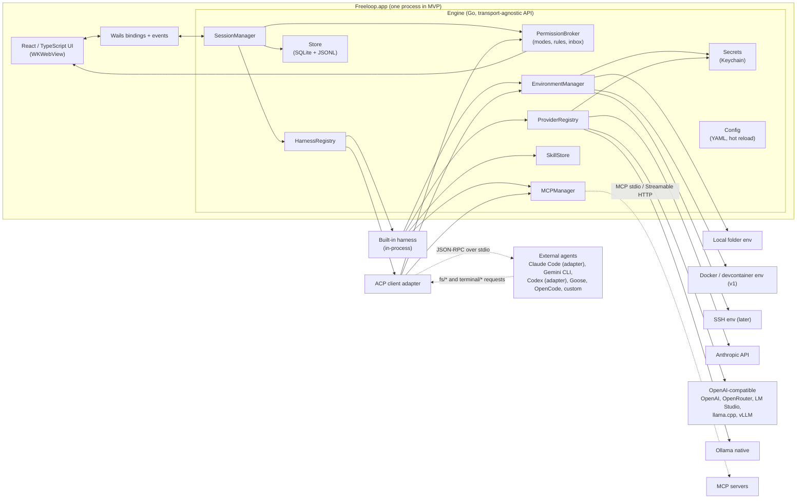

# Architecture

Architecture for **Freeloop**. M0 built the store, event schema, engine API, config skeleton and secrets interface (as `secrets.Store`); the rest is proposed; interface sketches are Go-flavoured pseudocode meant to fix names and responsibilities, not to compile. Requirement IDs refer to [REQUIREMENTS.md](REQUIREMENTS.md); unsettled points refer to [OPEN_QUESTIONS.md](OPEN_QUESTIONS.md).

## 1. Stack

| Layer | Choice | Why |
|---|---|---|
| Core (engine) | **Go** | Supervising many child processes (harnesses, MCP servers, shells, PTYs, git) with goroutines and contexts; one static binary; official Go SDKs for MCP, Anthropic, OpenAI and Google; the author is productive in it |
| Desktop shell | **Wails v3** (v3.0.0, released 2026-10-26, pinned) on WKWebView | Go-native shell with multi-window, generated TypeScript bindings for Go services, and an event bus; v2.17 as fallback (OQ-002) |
| Frontend | **React + TypeScript** | Largest component ecosystem and best AI-assisted code generation; the author will not hand-write most of it (OQ-004) |
| Harness protocol | **ACP** (Agent Client Protocol), JSON-RPC over stdio | Already spoken by Claude Code (via adapter), Gemini CLI, Codex (via adapter), Goose, OpenCode, Cline and 40-odd others; its permission and tool-call model is a good normalization target |
| Tools protocol | **MCP** via the official Go SDK (v1.7+, spec 2026-07-28, with older revisions for existing servers) | Stateless revision with `server/discover` and multi round-trip requests; the SDK handles version negotiation |
| Skills | **Agent Skills** (`SKILL.md`) | De facto standard; the author's existing skills load unchanged |
| Storage | **SQLite** (pure-Go driver) for index and metadata, **JSONL** per session for transcripts, **YAML** for config | Readable, greppable, crash-safe appends, no server |
| Secrets | **macOS Keychain** behind a `Secrets` interface | Never in files; platform backends swappable (NFR-XPLAT-002) |
| Git | Shell out to `git` | `go-git` lacks worktrees and lags on porcelain features; `git` is always present where this app is useful |

### Alternatives considered

| Alternative | Why not (for this project) |
|---|---|
| Python core with pywebview or PySide6 | Best agent-framework ecosystem, but packaging and signing a Python desktop app on macOS is a recurring tax, startup is slower, and the harness-authoring benefit is preserved anyway by running harnesses out of process over ACP |
| TypeScript with Electron | Official ACP and MCP TypeScript SDKs and the biggest contributor pool, but the author is not productive in TypeScript for backend work and the runtime is 150 MB plus Node |
| Tauri 2 with a Rust core | Smallest binaries and an official ACP Rust SDK, but Rust slows a solo developer's iteration and the author did not ask for it |
| Native SwiftUI | Best macOS feel, but Swift, macOS forever, and no ACP SDK |
| Pure-Go GUI (Fyne, Gio) | Rich text, markdown, diffs and accessibility are weak; a transcript view would look worse than every competitor |
| Wails v2 instead of v3 | Stable, but single-window and an older bindings model; chosen as fallback only |
| An existing Go agent framework (Genkit, Eino, LangChainGo, ADK) for the built-in harness | Each imposes its own loop and abstractions; the loop is the product here, and thin adapters over the three official SDKs plus one OpenAI-compatible adapter cover every listed provider |

## 2. Component diagram



## 3. Process model

**MVP: one process.** The Wails app hosts the engine in-process. Child processes are: external harnesses (ACP over stdio), stdio MCP servers, shell commands and PTYs spawned by environments, and `git`/`docker` invocations. Each child belongs to a process group owned by its session so cancellation kills the whole tree.

**Why not a daemon from day one.** A separate engine daemon would let sessions survive a GUI crash and give the headless CLI for free, at the cost of an IPC layer and process lifecycle work before anything else exists. The engine API is designed transport-agnostic (section 11) and all state is persisted per event (SES-002), so a GUI crash loses nothing but in-flight streams, and the daemon split can happen at v1 with EXT-004 (OQ-003).

**Concurrency.** The `SessionManager` runs each session as a goroutine group under a per-session `context.Context`. Provider calls go through a per-provider semaphore (OQ-013). Events fan out through a bus with bounded buffers; the store subscriber is synchronous (persist before publish), UI subscribers are asynchronous and may fall back to catch-up reads from the store if they lag. The race detector runs in CI; a chaos test runs ten sessions with random cancels.

## 4. Core abstractions

### 4.1 Provider

A configured model endpoint: one Anthropic key, one OpenRouter key, one local Ollama. Providers know nothing about agents.

```go
type Provider interface {
    ID() string
    Type() ProviderType                 // anthropic | openai_compat | ollama | (v1) gemini | openai_responses
    ListModels(ctx) ([]ModelInfo, error)
    Capabilities(model string) ModelCaps
    Stream(ctx, ChatRequest) (<-chan ChatEvent, error) // text deltas, thought deltas, tool-call deltas, usage, stop reason
    CountTokens(ctx, ChatRequest) (int, error)        // estimate when the API has no counter
}

type ModelCaps struct {
    Tools, ToolChoice, ParallelTools, StreamedToolArgs, StableToolCallIDs bool
    StructuredOutput, Vision, Reasoning, PromptCaching bool
    ContextWindow, MaxOutput int
}
```

Normalization rules live in one package: synthesize tool-call IDs when a runtime omits them (Ollama native returns an index only), buffer streamed tool arguments until the JSON is complete, map reasoning fields (`thinking`, `reasoning_content`, `reasoning`) to one `ThoughtDelta`, and disable parallel tool calls when `ParallelTools` is false. Local runtimes get a tool-calling probe on first use that fills `ModelCaps` (PRV-005, OQ-011).

### 4.2 Harness and sessions

A harness is anything that can run an agent session. The interface is deliberately shaped like ACP so that the ACP adapter is a one-to-one mapping and the built-in harness is "an ACP agent linked in-process".

```go
type Harness interface {
    Info() HarnessInfo                                  // id, name, kind (builtin|acp|cli), negotiated capabilities
    NewSession(ctx, SessionParams) (SessionHandle, error)
    LoadSession(ctx, externalID string, SessionParams) (SessionHandle, error) // replays history; only if capable
}

type SessionParams struct {
    Env        Environment
    Profile    Profile          // model, prompt, tools, policy, skills, MCP servers, limits
    Cwd        string
    MCPServers []MCPServerSpec  // resolved from profile + environment, paths valid inside Env
}

type SessionHandle interface {
    Prompt(ctx, []ContentBlock) (StopReason, error) // end_turn | max_tokens | max_turns | refusal | cancelled
    Cancel(ctx) error
    SetMode(ctx, ModeID) error                      // ask | accept_edits | plan | bypass, plus harness-defined modes
    SetConfig(ctx, key string, value any) error     // model, thought level, harness-specific options
    Events() <-chan Event
    Close() error
}
```

*As built in M1 (`internal/harness`):* sessions receive an `Emit(type, data)` function in their parameters instead of exposing an event channel, so every event goes straight to the store (persist, then publish); cancel is the prompt's context; `SetConfig` waits until a harness needs it. The built-in harness records each context message as a `history_message` event, which is how a session continues with its full context after a restart. A prompt is text plus embedded resources: the engine reads the files a message `@`-mentions through the session's environment and hands them to the harness, as an ACP client embeds resources, so mentions work the same for every harness (GUI-004); the transcript shows each one as a `resource_link` user content block.

The engine-side `Session` record is what the GUI lists:

```go
type Session struct {
    ID, ProjectID, EnvironmentID, HarnessID, ProfileID string
    ExternalID   string          // harness-side id for ACP session/load or session/resume
    Title        string
    Status       SessionStatus   // idle | running | waiting_permission | waiting_input | error | archived
    Model        ModelRef
    Mode         ModeID
    BaseCommit, Branch string    // for the diff panel and git badge
    Usage        Usage
    CreatedAt, UpdatedAt time.Time
}
```

### 4.3 Environment

Where a session's processes run and where its files are. Every tool execution, file access and PTY goes through this interface; a lint rule forbids `os/exec` and direct file I/O elsewhere in the engine (ENV-001).

```go
type Environment interface {
    ID() string
    Kind() EnvKind                     // local | docker | ssh
    Root() string                      // project root as seen inside the environment
    Capabilities() EnvCaps             // sandboxed, network, pty, setup/health supported
    Exec(ctx, ExecSpec) (Process, error) // argv, cwd, env (with secret refs resolved at spawn), stdin, pty, timeout, output caps
    FS() FileSystem                    // Read, Write, Stat, List, Glob, Grep; path policy enforced here
    Setup(ctx) error                   // post-create script (v1)
    Health(ctx) error
}
```

*As built in M1:* an environment's settings (variables, secret references, disabled tools, default mode) live in `environments/<id>.yaml` and are separate from where it runs: a local environment runs in the session's project folder, so one environment can serve several projects and sessions (ENV-003). A project is a row in SQLite with its root and a git fingerprint (first commit, origin URL) for relinking after a move (OQ-020). Secrets are read from the Keychain when a session's environment starts and passed as variables; every value is added to the transcript redaction list. The app's own git queries (`git status --porcelain=v2 --branch` after each finished tool call and turn) run through `Environment.Exec` with argv, outside the permission broker, because they are the app's reads rather than a harness's side effects.

The local implementation is thin wrappers over the OS. The Docker implementation (v1) runs `docker exec -i` for `Exec`, `docker cp` or `exec cat`/`tee` for `FS`, and reuses `.devcontainer/devcontainer.json` through the devcontainer CLI when present. Because ACP is stdio, an external harness runs *inside* an environment by spawning it through `Environment.Exec` with stdio pipes; the same path later covers `ssh`. MCP server commands passed to such a harness must be paths valid inside the environment.

### 4.4 Skill

```go
type Skill struct {
    Name, Description string          // name must equal directory name (spec)
    Dir         string
    Source      SkillSource           // app_store | project_freeloop | project_claude | project_agents | imported{from, at}
    License, Compatibility string
    Metadata    map[string]string
    AllowedTools []string             // experimental in the spec; used as a policy hint only
}

type SkillStore interface {
    Discover(ctx, project *Project) ([]Skill, error)   // app store, .freeloop/skills, .claude/skills, .agents/skills
    Enabled(scope Scope) []Skill
    SetEnabled(name string, scope Scope, on bool) error
    Import(src string, opts ImportOpts) (Skill, error)  // one-way copy with provenance
    Validate(dir string) []Issue                        // frontmatter rules from the spec
    Load(name string) (Body, error)                      // SKILL.md body plus file list, for load_skill
}
```

Progressive disclosure (SKL-004): the system prompt carries name and description of enabled skills; the `load_skill` tool returns the body; referenced files are read through the environment on demand; scripts run through `Environment.Exec` under the permission broker like any shell call.

### 4.5 ToolCall, permissions and policy

ACP's `session/request_permission` shape is the canonical approval event. The built-in harness and the ACP adapter both produce it; the GUI renders one dialog.

```go
type ToolCall struct {
    ID, Title string
    Kind      ToolKind      // read | edit | delete | move | search | execute | think | fetch | switch_mode | other
    Status    ToolStatus    // pending | in_progress | completed | failed
    Tool      string        // canonical: shell, edit_file, mcp__<server>__<tool>, acp:<raw title>
    RawInput, RawOutput json.RawMessage
    Content   []ToolContent // text | diff{path, old, new} | terminal{id}
    Locations []Location    // {path, line}
}

type PermissionRequest struct {
    ID, SessionID string
    ToolCall      ToolCall
    Options       []PermissionOption // kinds: allow_once | allow_always | reject_once | reject_always
    RequestedAt   time.Time
}

type Rule struct {
    Effect  Effect   // allow | deny
    Tool    string   // shell | edit_file | write_file | mcp__github__* | skill:<name> | acp:*
    Match   Matcher  // prefix (commands), glob (paths), namespace (MCP), exact
    Scope   Scope    // global | environment | profile | project | session
    Source  string   // file and line the rule came from
}

type Decision struct {
    OptionKind OptionKind
    Actor      Actor        // user | rule{id} | mode{name} | protected_path
    Persisted  *Scope       // when the user chose "allow always", where it was saved
}

type PermissionBroker interface {
    Request(ctx, PermissionRequest) (Decision, error) // blocks until decided or ctx cancelled
    Pending() []PermissionRequest                     // feeds the attention view
    Decide(requestID, optionID string, persistAs *Scope) error
}
```

Evaluation order in `Request`: protected paths (SEC-005, always deny) → deny rules at any scope (they hold even in `bypass`) → environment constraints (a sandboxed environment may auto-allow execution; v1) → session mode (`plan` denies writes and execution, `bypass` allows all) → allow rules → `accept_edits` allows edits under the project root, reads inside the root are allowed → queue for the user. *As built in M1:* scopes are global (`rules.yaml`) and session (rules created by "Allow always", recorded as the `persisted` rule of a `permission_decided` event and rebuilt from the transcript); a shell prefix rule (`git *`) approves only a single plain command, never a chain, pipe, substitution or redirection, while an exact rule matches exactly the line it names (spaces and tabs collapsed, newlines kept) and a deny rule matches any command in a line, looking through wrappers such as `env`, subshells and `sh -c`. Rules created by "Allow always" are `literal`: their command or path is matched as written, never as a pattern. When `rules.yaml` has errors the broker fails closed (everything except reads inside the project asks) and the app refuses to rewrite the file until it is fixed. Paths reach the broker resolved (`Environment.Resolve` follows symlinks), and containment checks ignore case. "Allow always" writes a rule into the chosen scope's YAML. Cancelling a turn resolves pending requests as `cancelled`, which the ACP adapter forwards as the protocol requires. *As built in M2:* the attention view (GUI-002) is `Engine.Attention`, which joins `Pending()` with the session index: every session with pending requests, in `waiting_input`, or in `error` (a turn that failed, or a prompt whose session could not start, sets `error` until the next prompt or `DismissError`); the GUI refreshes it on `permission_requested`, `permission_decided` and `session_status` events, so there is no separate attention queue table.

This mirrors Codex's separation of sandbox from approval policy: the environment says what is *possible*, the policy says when to *ask*.

### 4.6 Events

One versioned schema (EXT-002), a strict superset of ACP's `session/update` variants so the ACP mapping is one-to-one (OQ-012):

| From ACP | Added by Freeloop |
|---|---|
| `user_message_chunk`, `agent_message_chunk`, `agent_thought_chunk`, `tool_call`, `tool_call_update`, `plan`, `available_commands_update`, `current_mode_update`, `config_option_update`, `session_info_update`, `usage_update`, `notice`, `compaction_update`, `compaction_summary_chunk` | `turn_started`, `turn_ended{stopReason}`, `permission_requested`, `permission_decided{actor, scope}`, `session_status`, `git_state`, `model_changed`, `env_health`, `hook_ran` (v1), `error`, `history_message` (built-in harness context, not rendered) |

Transcript line format: `{"v":1,"seq":412,"ts":"2026-10-24T09:12:03.120Z","sid":"…","type":"tool_call","data":{…}}`. `data` is the ACP update object without its `sessionUpdate` discriminator, with ACP's camelCase field names; Freeloop's own payloads use camelCase too. The store writes each event with one write call before publishing it (an app crash loses at most the event being written), fsyncs dirty transcripts every 200 ms and on close, and truncates a torn last line on open. `seq` is contiguous per session, so a UI subscriber that misses events notices the gap and catches up from the store.

## 5. Harness adapters

- **Built-in** (`harness/builtin`): implements `Harness` directly. Loop: assemble system prompt (profile prompt, instruction files per HRN-010, skills index, environment facts) → `Provider.Stream` → assemble tool calls → for each call: `PermissionBroker.Request` → execute through `Environment`, `MCPManager` or `SkillStore` → append results → repeat until stop reason or limits. Parallel independent calls and subagents at v1 (HRN-014); compaction at v1 (HRN-013).
- **ACP client** (`harness/acp`): generic. Spawns the agent through `Environment.Exec`, runs `initialize`, negotiates capabilities, `session/new` with `cwd` and `mcpServers`, streams `session/update` into events, routes `session/request_permission` to the broker, fulfils `fs/*` and `terminal/*` requests through the environment with path policy applied, uses `session/load` or `session/resume` when the agent advertises them and otherwise re-creates with a summary (SES-003). Built on `coder/acp-go-sdk` (community, schema-generated), vendored so a protocol bump means regenerating, not waiting.
- **Claude Code preset**: the ACP adapter configured with Zed's Claude Code ACP adapter as the command (OQ-005). Login happens in Claude Code's own flow; the app passes no credentials and reads none (HRN-008).
- **CLI wrapper** (`harness/cli`, fallback only): for agents with a streaming JSON mode but no ACP. Not planned unless the ACP route for Claude Code fails.

Presets are YAML entries (command, args, env, auth notes, known quirks); adding an agent that speaks ACP needs no Go.

## 6. MCP management

Built on the official Go SDK (v1.7+). Each configured server gets one client. On connect the manager calls `server/discover` to select the protocol revision and read capabilities; the SDK handles the `initialize` handshake for servers on 2025-11-25 and earlier. Under 2026-07-28 the design is stateless: every request carries version and client capabilities in `_meta`, there is no session ID, and `tools/list` results carry `ttlMs` so the manager caches tool lists per server. When a `tools/call` returns `resultType: "input_required"`, the manager turns the input requests into inbox forms and retries the call with `inputResponses` (MCP-008); older servers' `elicitation/create` requests take the same path. Roots, sampling and logging are deprecated in the current revision and are not implemented. OAuth (v1) uses the SDK's authorization package with Client ID Metadata Documents, Dynamic Client Registration as fallback, issuer validation, and tokens in the Keychain keyed by issuer (MCP-006).

Tools are exposed to the built-in harness as `mcp__<server>__<tool>` with the server's annotations preserved, so rules can match on namespace (MCP-003). For ACP harnesses the same server list is passed on `session/new` as stdio entries always and `http` entries when the agent advertises `mcpCapabilities.http` (MCP-004).

## 7. Skills

Discovery locations in precedence order: `.freeloop/skills/` in the project, `.agents/skills/` and `.claude/skills/` in the project (read-only), the app skill store. Validation follows the spec: `name` 1 to 64 lowercase characters equal to the folder name, `description` 1 to 1024 characters, body under 500 lines recommended. Imports from `~/.claude/skills` copy into the app store with provenance (SKL-003); the app never writes into `~/.claude` or `.claude/`. How enabled skills reach external harnesses is open (OQ-006, SKL-008).

## 8. Providers in detail

Thin adapters over the official Anthropic, OpenAI and Google Go SDKs plus one OpenAI-compatible adapter with presets. *As built in M1:* the OpenAI-compatible adapter (`internal/provider/openaicompat`) is hand-written rather than built on the OpenAI SDK, so it can absorb endpoint deviations; the official OpenAI SDK arrives with the native Responses provider (PRV-012). Capabilities resolve in this order: the user's per-model override in `providers.yaml`, a cached probe result in `capabilities.yaml`, what the endpoint reports (Ollama `/api/show`), and the adapter's static knowledge; a model still unknown is probed when a session starts (OpenAI, OpenRouter with its attribution headers, LM Studio, llama.cpp server, vLLM, Ollama `/v1`), and an Ollama native adapter for `/api/chat`, `/api/tags`, `/api/show`. Known differences the capability table must capture: Ollama's compatible endpoint has no `tool_choice` and no documented tool-call IDs; its native API returns an index per call; llama.cpp needs `--jinja` for tools; LM Studio's streamed tool-call shapes deviate from OpenAI; vLLM is close to parity. Requests and responses are recorded as fixtures for replay tests (NFR-REL-003).

## 9. Data storage

```
~/Library/Application Support/freeloop/
  config.yaml              general settings and defaults (SET-001, SET-004)
  providers.yaml           providers; secrets as keychain references only
  profiles/<id>.yaml       harness profiles (HRN-003)
  environments/<id>.yaml   environments (ENV-002)
  mcp.yaml                 MCP servers (MCP-001)
  rules.yaml               global permission rules (SEC-002)
  skills/<name>/           app skill store (SKL-002)
  presets/harnesses/*.yaml ACP agent presets (HRN-006, HRN-007)
  freeloop.db              SQLite: projects, environments, sessions, attention queue, usage, (v1) FTS5 index
  sessions/<id>/events.jsonl   append-only transcript (SES-002)
  sessions/<id>/attachments/
  logs/                    local only, secrets redacted
```

Project level, read after trust (SEC-006): `.freeloop/{profiles/,skills/,mcp.yaml,rules.yaml,environment.yaml}` plus `AGENTS.md` and `CLAUDE.md` read-only.

Secret references look like `keychain://freeloop/providers/anthropic` and are resolved only at spawn or request time (ENV-004). Config files are validated against JSON Schemas in `schemas/` and hot-reloaded with a file watcher. *As built in M1:* the watcher polls the size and modification time of `config.yaml`, `providers.yaml`, `rules.yaml` and `environments/*.yaml` every second instead of using file-system notifications, which needs no dependency and meets SET-001's two seconds; a changed file is reloaded, its problems replace that file's earlier ones in `ConfigIssues`, and the UI is told on the `freeloop:config` Wails event. Running sessions keep the provider and environment they started with; permission checks see new rules at once.

## 10. GUI to engine

Wails v3 exposes Go services as generated TypeScript bindings for request/response and an event bus for streams. The engine's public surface is one Go package (`engine`) with plain request and response types; the Wails service layer is a thin adapter over it. A second adapter exposing the same package as JSON-RPC over a Unix socket gives the headless CLI and the optional daemon split at v1 (EXT-004, OQ-003) without touching engine code.

Frontend state is one reducer per session over the event schema, so the transcript view is a pure function of events, which also makes replay from JSONL trivial. Message deltas are coalesced at about 30 ms for rendering while being persisted as received. The transcript list is virtualized (NFR-PERF-002); tool outputs load lazily.

## 11. Plugin and extension model

- **Files:** profiles, environments, rules, MCP servers, provider configs, harness presets, skills.
- **Processes:** ACP harnesses (any language), MCP servers, hooks (v1, EXT-005: JSON on stdin, exit code contract).
- **Schemas:** events, profiles, rules and presets are published JSON Schemas; the harness SDK templates (v1, EXT-003) are generated projects that already pass the ACP test kit.
- **Not offered:** in-process plugins or UI plugins before a concrete need appears (OQ-016). Go's `plugin` package is not an option on macOS for this use.

## 12. Security boundaries

- Secrets exist only in the Keychain and in the memory of the process that needs them; child processes receive only the variables their environment configures (SEC-008).
- The environment's `FS` and `Exec` enforce protected paths for every caller, including an external agent's `fs/*` and `terminal/*` requests, so a harness cannot bypass policy by using the protocol instead of a tool.
- The permission broker is the single chokepoint for side effects (SEC-003); nothing auto-approves on timeout.
- Project configuration, skills and hooks are inert until the project is trusted (SEC-006).
- The transcript is the audit log; redaction by known secret value runs before persistence (SEC-004).
- Update checks are opt-in and the only outbound connection not configured by the user (SEC-009).

## 13. Testing strategy

Engine packages have unit tests. Providers are tested against recorded fixtures with a replaying HTTP server. The ACP adapter is tested against the protocol's example agent and compatibility kit, and nightly against the Claude Code and Gemini CLI presets where credentials exist. The built-in harness is tested with a scripted fake provider that emits planned tool calls. Environments use temporary directories, and the Docker environment uses a small image in CI. The GUI is tested through the engine API plus a handful of component tests; Wails end-to-end tests are limited to a smoke launch.

## 14. Repository layout

```
cmd/freeloop/              Wails app entry point
internal/engine/           transport-agnostic API (requests, responses, event bus)
internal/session/          SessionManager, Session records, attention queue
internal/harness/          Harness interface, registry, presets
internal/harness/builtin/  the built-in loop and tools
internal/harness/acp/      ACP client adapter (vendored SDK under third_party/)
internal/provider/         Provider interface; anthropic, openaicompat, ollama
internal/environment/      Environment interface; local (docker at v1)
internal/permission/       broker, modes, rules, matchers
internal/skill/            discovery, validation, import, load
internal/mcp/              MCPManager on the official SDK
internal/store/            SQLite and JSONL
internal/secrets/          Secrets interface; darwin Keychain backend
internal/config/           YAML loading, schemas, hot reload
internal/platform/darwin/  notifications, dialogs, open-in-editor
frontend/                  React + TypeScript
schemas/                   events.json, profile.json, rules.json, preset.json
docs/
```
